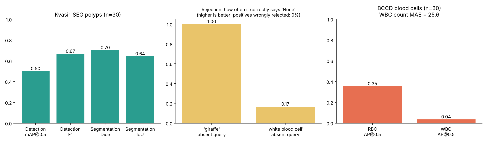
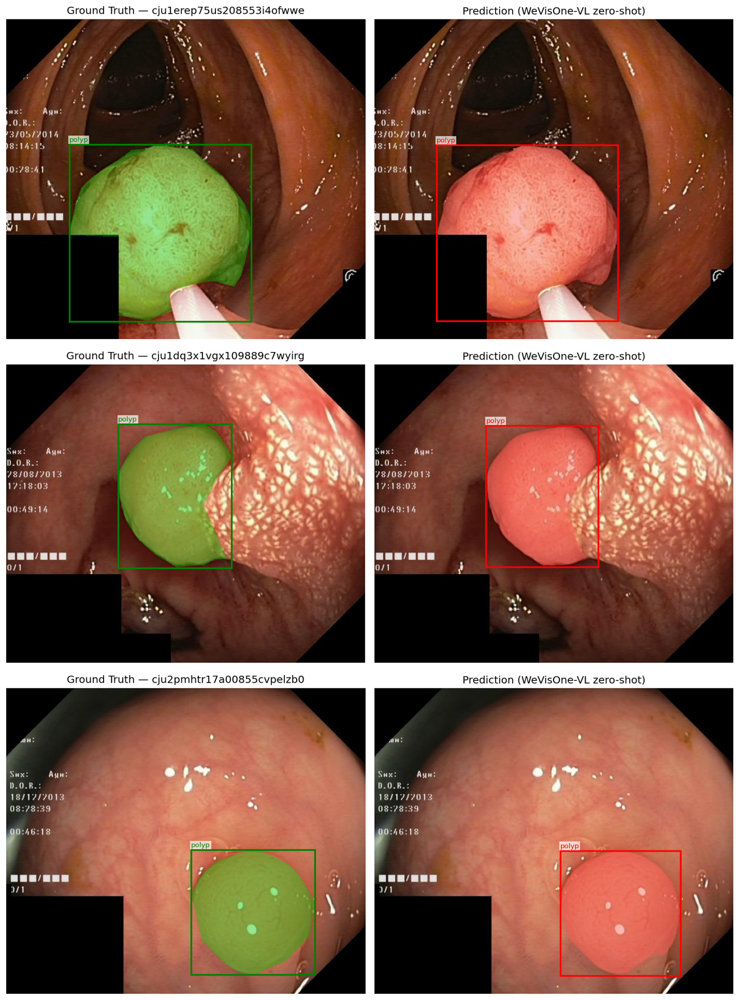
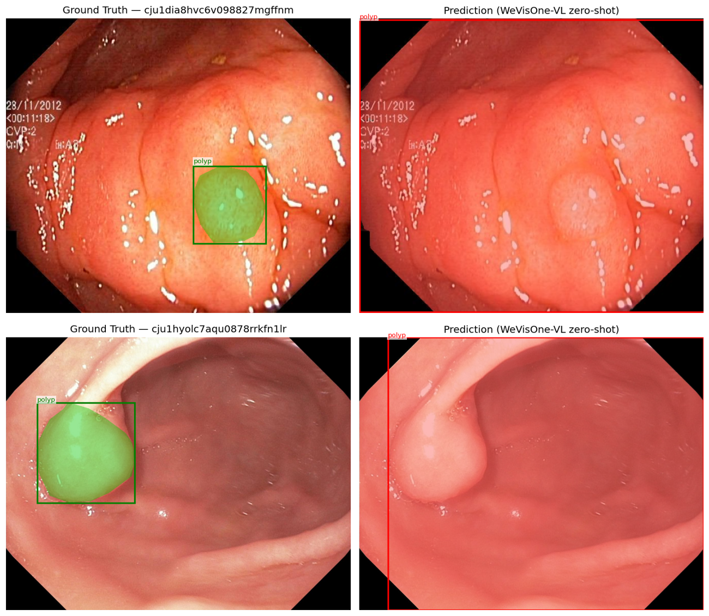

# MedPercept-Bench

### How far can a brand-new vision-language model get on medical images **without any medical training**?

A zero-shot evaluation of Tencent's **WeVisOne-VL-2B** (released Oct 2026) on colonoscopy polyps (Kvasir-SEG) and blood-cell smears (BCCD).
Built, run and written up as a learning project during my search for a research-based MS → PhD position.

[](https://colab.research.google.com/github/naveed1011/MedPercept-Bench/blob/main/notebooks/MedPercept_Bench_Colab.ipynb)

## TL;DR

- **It surprised me on polyps.** With the single prompt `polyp` and no fine-tuning, WeVisOne-VL-2B drew boxes and masks that line up closely with the expert annotation on most images I looked at (Dice **0.70**, IoU **0.64**, n = 30).
- **It is not perfect.** About two-thirds of its boxes matched at IoU ≥ 0.5 (F1 **0.67**). The misses are informative: on small or subtle polyps it sometimes gives up and boxes the whole frame.
- **It is much weaker on blood cells.** Asked for *white blood cells* it returned about 25 boxes per image, so counting failed (MAE 25.6) and WBC AP was only 0.04.
- **It knows what is *not* there, but only for obviously unrelated things.** `giraffe` was rejected 30/30 times, but `white blood cell` on a colonoscopy image was rejected only 5/30 times.



## What I tested

| Dataset | Task | Prompts | Images |
|---|---|---|---|
| Kvasir-SEG (polyps) | referring segmentation, detection | `polyp` | 30 |
| Kvasir-SEG | rejection on *absent* concepts | `giraffe`, `white blood cell` | 30 × 2 |
| BCCD (blood cells) | open-vocabulary detection | `red blood cell`, `white blood cell` | 30 |
| BCCD | counting | `white blood cell` | 30 |

The model is frozen (no training of any kind) and runs on a free Colab T4. Metrics are in `src/metrics.py` (13 unit tests).

## Results

| Task | Metric | Result |
|---|---|---|
| Kvasir detection | mAP@0.5 / micro-F1 | 0.50 / 0.67 |
| Kvasir segmentation | mean Dice / mean IoU | 0.70 / 0.64 |
| Kvasir rejection | correct "None" on absent concepts / wrongly rejected polyps | 58% (35 of 60) / 0% |
| BCCD detection | AP@0.5: red blood cell / white blood cell | 0.35 / 0.04 |
| BCCD counting (WBC) | MAE / exact match | 25.6 / 0% |

Raw numbers: [`results/metrics_summary.csv`](results/metrics_summary.csv). Per-image predictions: `results/predictions/`.

> **How to read these.** n = 30 images per task, one run, one model size, so treat every number as a rough indication rather than a benchmark score.
> The model returns no confidence scores (all 1.0), so "mAP" here is really precision/recall at a single operating point.

## What it does well: finding polyps it was never trained on

Ground truth (green, left) vs WeVisOne-VL prediction (red, right) for each image. Same prompt, no fine-tuning.
The boxes follow the polyp outline, and the segmentation mask reproduces the shape, including irregular lobed polyps.



Across the 13 gallery images I saved ([`results/figures/`](results/figures)), 11 are close matches. Some boxes are a little too loose or too tall, which is what pulls IoU down even
when the localisation is clearly right.

## Where it breaks

**1. Subtle polyps: the model falls back to a full-frame box.** In 2 of the 13 gallery images (below), the polyp is small or low-contrast and the prediction is a box around the whole image.



**2. Blood cells.** WBC AP of 0.04 and about 25 predicted "white blood cells" per image (the counting predictions range from 11 to 35 and none matched exactly) suggest the
model is boxing red blood cells when asked for white ones. That is a *hypothesis*: I have not yet drawn overlays for BCCD to confirm it, but RBC AP (0.35) being much higher than WBC AP (0.04) points the same way. A natural-image model has seen plenty of "cells"-like blobs but not this fine-grained distinction.

**3. Rejection is selective.** It never wrongly rejected a real polyp (0% false rejection), and it rejected `giraffe` every time (30/30), but it only said "None" for `white blood cell` on 5 of 30 colonoscopy images. Plausible-sounding medical concepts are more likely to be hallucinated than clearly absurd ones.

## What I learned

1. A natural-image foundation model transfers **partly** to medical images: coarse localisation and shape are surprisingly good, fine-grained class distinctions (RBC vs WBC) are not.
2. Strict IoU metrics under-state "roughly right" behaviour, so I read the overlays next to the numbers. The numbers alone would have hidden the polyp successes, and the overlays alone would have hidden the blood-cell failures.
3. Rejection testing is worth doing: a model that never says "None" is dangerous for medical use, and one that only rejects absurd prompts is not much better.
4. Evaluation code has to **fail loudly**. My first Colab run silently processed 0 images because a dataset download failed.
5. Running a 2B VLM on a free T4 is mostly memory engineering (next section).

## Engineering notes: problems I hit and how I fixed them

| Problem | Fix |
|---|---|
| Colab out-of-memory crashes | Upstream default is about 2000 visual tokens per image. I cap image size (`max_pixels` ≈ 0.8 MP) and answer length (1024 tokens) in `configs/datasets.yaml`. |
| Install crashed the session | Upstream `requirements.txt` pins `torch 2.11` and `vllm`. The notebook installs only small packages and uses `pip install --no-deps -e`. |
| One bad image killed the whole run | GPU OOM is logged as `error="oom"`, skipped in the metrics and retried on the next run. |
| Lost progress after a crash | Every image is saved as it finishes; re-running **resumes**. |
| Dataset download SSL error | `download_data.sh` retries with `--insecure` and `wget`, and aborts if a dataset is empty. |

## Reproduce it (free Colab T4)

1. Put this folder in Google Drive at `MyDrive/MedPercept-Bench`.
2. Open `notebooks/MedPercept_Bench_Colab.ipynb` and select a **T4 GPU** runtime.
3. Run the cells in order. Start with `PRESET = 'smoke'` (5 images), then `'quick'` (30, what I report here), then `'standard'` (100).
4. Rebuild the README figures with `python scripts/make_readme_figures.py`.

No GPU? `python scripts/run_inference.py --mock && python scripts/evaluate.py --mock` runs the whole pipeline with a mock predictor on synthetic data.
Those numbers only prove the code runs; they say nothing about the model.

## Repository layout

```
MedPercept-Bench/
├── README.md
├── LICENSE
├── requirements.txt
├── configs/datasets.yaml        # subset sizes, max_pixels, token limits
├── notebooks/                   # Colab notebook (memory-safe, resumable)
├── src/                         # model wrapper, datasets, metrics, plotting
├── scripts/                     # download_data.sh, run_inference.py, evaluate.py,
│                                # make_gallery.py, make_readme_figures.py
├── tests/                       # metric unit tests
├── results/
│   ├── metrics_summary.{csv,json}
│   ├── predictions/             # aggregated model outputs (per-image cache is git-ignored)
│   └── figures/                 # all 13 ground-truth vs prediction overlays
├── assets/figures/              # figures used in this README
└── docs/results_schema.md       # format of the prediction files
```

## Limitations and next steps

- Small sample (30 images per task), single run, 2B model only, no confidence intervals. The next step is the `standard` preset (100 images) and the 4B model.
- Kvasir boxes are derived from the masks, so box metrics partly depend on that conversion.
- Prompts were not tuned. A prompt like "red blood cell vs white blood cell" might change the BCCD picture.
- BCCD overlays are still to do, to confirm the red-vs-white blood cell hypothesis.
- Not a clinical evaluation. Research and learning only.

## Credits

- WeVisOne-VL, Tencent WeChat Vision: <https://github.com/Tencent/WeVisOne-VL>
- Kvasir-SEG (Jha et al., 2020) and the BCCD dataset (Shenggan)
- Author: Naveed, <https://naveed1011.github.io/>
